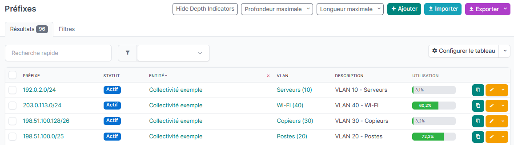
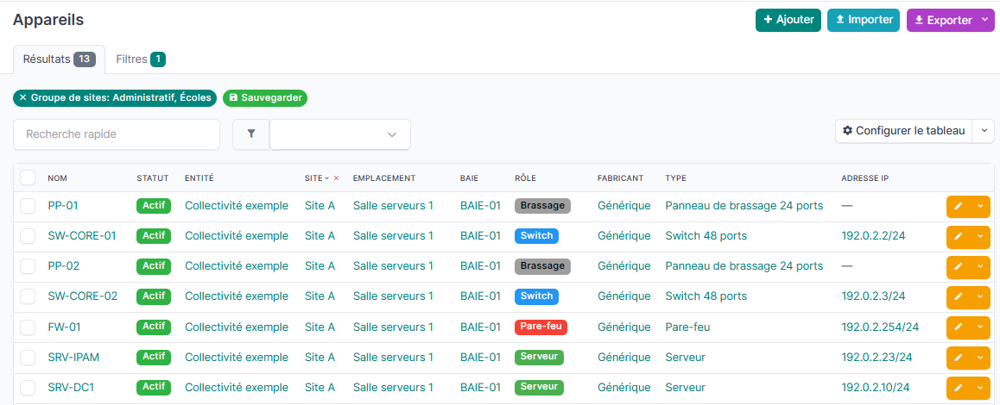
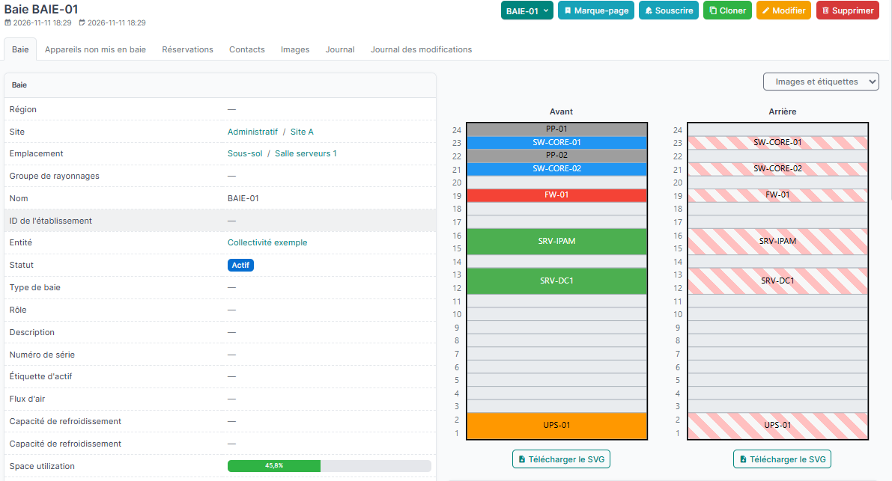

# Partie D — IPAM, DCIM et source de vérité

[← Partie C — Mise en production](../Partie%20C%20%E2%80%94%20Mise%20en%20production/mise-en-production.md) · [Retour au README](../README.md) · [Partie E — Comptes et droits →](../Partie%20E%20%E2%80%94%20Comptes%20et%20droits/comptes-et-droits.md)

---

## La notion de source de vérité

Une **source de vérité** (*source of truth*) est la référence unique et à jour que tout le monde consulte avant d'agir. Si NetBox et une autre source divergent, on corrige l'autre source ou on vérifie sur le terrain, mais on ne laisse jamais deux versions coexister.

Règles posées :

- toute IP fixe est d'abord **réservée dans NetBox**, avant d'être configurée sur l'équipement ;
- **tout ce qui a une IP fixe doit être dans NetBox**, y compris les équipements hors du périmètre réseau habituel (chaufferies, alarmes, lecteurs de badges) ;
- **rien n'est inventé** : une donnée incertaine reste hors de NetBox, dans un fichier « à valider », ou porte la mention « à confirmer » en description ;
- un réseau encore actif mais destiné à disparaître passe au statut **Obsolète** plutôt que d'être supprimé.

> [!NOTE]
> Une source de vérité ne vaut que si l'équipe l'utilise. Tous les agents disposent donc d'un compte, et la règle d'usage est écrite dans la documentation utilisateur.

### Lien avec la supervision

L'objectif est que tout ce qui est dans NetBox soit supervisé, et inversement, avec des noms harmonisés entre les deux outils. Une exception est assumée : les copieurs sont dans NetBox mais pas dans la supervision, car ils sont éteints la nuit et génèreraient de fausses alertes.

## Hiérarchie des sources

Pour alimenter NetBox, les sources ont été classées de la plus fiable à la moins fiable :

| Rang | Source | Données |
|---|---|---|
| 1 | Configuration du pare-feu (accès en lecture seule) | VLAN, passerelles, plages DHCP, réservations, réseaux des sites distants (tunnels VPN) |
| 2 | Prestataire du réseau des écoles | Plages DHCP des écoles |
| 3 | Référent métier | Copieurs et imprimantes (tableau de référence) |
| 4 | Supervision (CheckMK) et découverte réseau (LibreNMS) | Équipements et leurs IP |
| 5 | Ancien tableur des VLAN | À confronter aux autres sources, jamais repris tel quel |

> [!TIP]
> La configuration du pare-feu s'est révélée la source la plus fiable pour la partie réseau : elle a contredit le tableur existant sur plusieurs points (un masque en /24 au lieu de /16, un DHCP présent alors qu'il était noté absent).

## Fonctionnalités IPAM utilisées

| Fonctionnalité | Utilisation | Ce que cela apporte |
|---|---|---|
| **VLAN** | 19 VLAN, dont 2 au statut Obsolète | vue complète de la segmentation du réseau |
| **Préfixes** | 19 préfixes, chacun lié à son VLAN, passerelle en description, portée sur un site pour les sites distants | chaque réseau est rattaché à son VLAN et à son lieu |
| **Plages d'adresses** | 15 plages DHCP, statut Actif, cases « peuplé » et « utilisé » cochées | les plages DHCP apparaissent occupées : on ne peut pas y attribuer une IP fixe par erreur |
| **Adresses IP** | rattachées à l'interface de l'appareil, marquées IP primaire | on sait quel équipement porte chaque IP |
| **Statuts** | Actif, Réservé, Obsolète, DHCP | l'état de chaque objet est explicite |
| **Jauges d'utilisation** | contrôlées après chaque import | anticiper la saturation d'un réseau |
| **Adresses IP disponibles** | onglet d'un préfixe | trouver immédiatement une IP libre |

<p align="center"></p>
<p align="center"><em>Préfixes rattachés à leur VLAN, avec leur jauge d'utilisation : les plages DHCP marquées comme utilisées remplissent la jauge (données d'exemple).</em></p>

## Fonctionnalités DCIM utilisées

| Fonctionnalité | Utilisation | Ce que cela apporte |
|---|---|---|
| **Groupes de sites et sites** | 37 sites classés par type (administratif, écoles, sport, petite enfance, sites distants…) | filtrer et regrouper les équipements par lieu |
| **Localisations** | 41 localisations hiérarchisées (bâtiment, étage, salle serveurs) | savoir précisément où se trouve un équipement |
| **Rôles d'appareils** | 16 rôles (switch, borne Wi-Fi, copieur, onduleur, chaufferie, alarme, lecteur de badges, PC…) | classer le parc par fonction |
| **Fabricants et types d'appareils** | 12 fabricants, 33 types, plus un type générique par rôle avec le fabricant « Non renseigné » quand la marque est inconnue | ne bloquer aucun import faute d'information, sans rien inventer |
| **Appareils et interfaces** | environ 150 appareils, chacun avec une interface `LAN` (1000base-t) et son IP primaire | lier l'inventaire physique à l'inventaire IP |
| **Baies** | modélisation des baies en élévation : position en U de chaque équipement, faces avant et arrière | visualiser l'occupation d'une baie et la place disponible sans se déplacer |

<p align="center"></p>
<p align="center"><em>Appareils avec leur site, leur emplacement, leur baie, leur rôle, leur type et leur IP primaire (données d'exemple).</em></p>

<p align="center"></p>
<p align="center"><em>Élévation d'une baie, faces avant et arrière : chaque équipement apparaît à sa position en U, avec la couleur de son rôle (données d'exemple).</em></p>

### Fonctions transverses

- **Import CSV** par l'interface web (voir ci-dessous).
- **Journal des modifications** : qui a modifié quoi, et quand.
- **Autorisations** par type d'objet et par action (voir [Partie E — Comptes et droits](../Partie%20E%20%E2%80%94%20Comptes%20et%20droits/comptes-et-droits.md)).
- **Descriptions normalisées**, avec les sigles internes des services.

## Méthode d'alimentation des données

Les données ont été importées **par fichiers CSV, via l'interface web de NetBox** (fonction *Import en masse*). Aucun script d'import ni aucun appel à l'API n'a été utilisé.

1. **Extraction** des données : exports CSV de la supervision et de l'outil de découverte, tableaux des référents, lecture de la configuration du pare-feu.
2. **Préparation** des fichiers CSV : tri, nettoyage, dédoublonnage et croisement des sources.
3. **Sauvegarde manuelle** de la base avant chaque lot.
4. **Annonce du résultat attendu** avant l'import (nombre d'objets, évolution des jauges).
5. **Import** lot par lot, puis **vérification** du résultat obtenu.

### Ordre d'import

Les objets dépendent les uns des autres : un appareil a besoin de son site, de son rôle et de son type ; une IP a besoin de son appareil et de son interface. L'ordre d'import est donc imposé :

```text
Groupes de sites → Sites → Localisations (parents puis enfants)
→ Rôles → Fabricants → Types d'appareils
→ VLAN → Préfixes → Plages
→ Appareils → Interfaces → Adresses IP (avec is_primary)
```

### Formats CSV

Les en-têtes ci-dessous sont ceux utilisés pour chaque type d'objet, avec une ligne d'exemple fictive. Ils sont présentés dans l'ordre d'import.

```csv
# Groupes de sites
name,slug,description
Administratif,administratif,Bâtiments administratifs

# Sites
name,slug,status,group,description
Site A,site-a,active,Administratif,Bâtiment principal

# Localisations (parents, puis enfants avec la colonne parent)
site,name,slug,status,description
Site A,Sous-sol,site-a-sous-sol,active,
site,parent,name,slug,status,description
Site A,Sous-sol,Salle serveurs 1,site-a-salle-serveurs-1,active,

# Rôles d'appareils
name,slug,color
Copieur,copieur,2196f3

# Fabricants
name,slug
Non renseigné,non-renseigne

# Types d'appareils
manufacturer,model,slug,u_height
Non renseigné,Copieur générique,copieur-generique,0

# VLAN
vid,name,status,description
10,Serveurs,active,Passerelle 192.0.2.254

# Préfixes
prefix,status,vlan,description
192.0.2.0/24,active,Serveurs,Passerelle 192.0.2.254

# Plages d'adresses (masque obligatoire)
start_address,end_address,status,description
192.0.2.100/24,192.0.2.150/24,active,Plage DHCP VLAN 10 - ne pas attribuer d'IP fixe

# Appareils
name,role,manufacturer,device_type,site,location,status,serial,description
COPIEUR-01,Copieur,Non renseigné,Copieur générique,Site A,Sous-sol,active,,Accueil

# Interfaces
device,name,type
COPIEUR-01,LAN,1000base-t

# Adresses IP
address,status,device,interface,is_primary
198.51.100.40/24,active,COPIEUR-01,LAN,true
```

> [!WARNING]
> Un import CSV qui contient **une seule erreur n'importe rien**. Renommer un objet entre la préparation et l'import suffit à casser le fichier : tout renommage est donc annoncé avant l'import.

## Évolutions envisagées

- **VRF** par site distant, pour gérer les sites qui réutilisent la même plage d'adresses privées.
- **Câblage** : connexions entre équipements, panneaux de brassage et tiroirs optiques.
- **Virtualisation** : clusters Hyper-V et machines virtuelles.
- **Automatisation** :
  - script Python avec `pynetbox` pour alimenter NetBox depuis l'API de la supervision ;
  - contrôle de cohérence NetBox ↔ supervision (IP présentes d'un côté et pas de l'autre) ;
  - jeton d'API dédié, avec des droits minimaux, rangé dans le gestionnaire de mots de passe ;
  - scan réseau de contrôle, **uniquement avec l'accord du RSSI**.

---

[← Partie C — Mise en production](../Partie%20C%20%E2%80%94%20Mise%20en%20production/mise-en-production.md) · [Retour au README](../README.md) · [Partie E — Comptes et droits →](../Partie%20E%20%E2%80%94%20Comptes%20et%20droits/comptes-et-droits.md)
