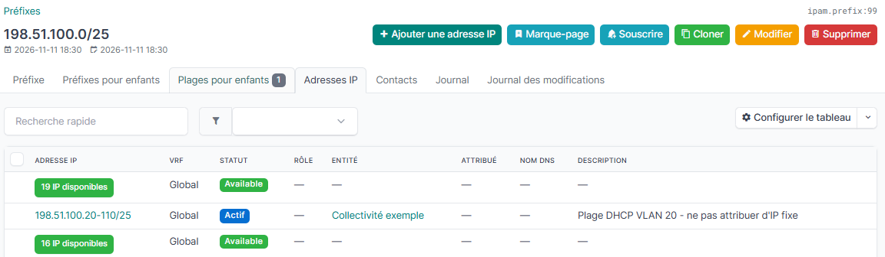

# Partie F — Utilisation au quotidien

[← Partie E — Comptes et droits](../Partie%20E%20%E2%80%94%20Comptes%20et%20droits/comptes-et-droits.md) · [Retour au README](../README.md) · [Partie G — Difficultés et leçons retenues →](../Partie%20G%20%E2%80%94%20Difficult%C3%A9s%20et%20le%C3%A7ons%20retenues/difficultes-et-lecons.md)

---

NetBox est accessible depuis un navigateur à l'adresse `https://ipam.example.org`, avec son compte nominatif.

## Attribuer une IP fixe

> [!IMPORTANT]
> On réserve toujours l'IP dans NetBox **avant** de la configurer sur l'équipement.

1. Ouvrir le préfixe du réseau concerné (*IPAM → Préfixes*).
2. Onglet **Adresses IP** : NetBox affiche les blocs d'adresses libres, en tenant compte des plages DHCP marquées comme occupées.
3. Créer l'adresse IP dans NetBox (statut Actif ou Réservé).
4. Configurer ensuite l'équipement avec cette IP.

<em>Onglet Adresses IP d'un préfixe : NetBox affiche les blocs d'adresses disponibles autour de la plage DHCP, où aucune IP fixe ne doit être attribuée (données d'exemple).</em>

## Ajouter un nouvel équipement

1. Créer l'appareil : nom, site, localisation, rôle, type d'appareil, statut.
2. Lui ajouter son interface `LAN`.
3. Rattacher son adresse IP à cette interface et la marquer comme **IP primaire**.

## Changement ou retrait d'un équipement

- Changement d'IP : mettre à jour l'adresse dans NetBox au moment du changement.
- Retrait : passer l'équipement au statut **Obsolète**, ou le supprimer s'il a définitivement quitté le parc.

## Rechercher une information

- **Barre de recherche globale** : par adresse IP, nom d'équipement ou numéro de série.
- **Filtres** dans les listes : par site, rôle, VLAN, statut.
- **Jauges d'utilisation** des préfixes : repérer un réseau proche de la saturation.
- **Journal des modifications** : savoir qui a changé quoi, et quand.

---

[← Partie E — Comptes et droits](../Partie%20E%20%E2%80%94%20Comptes%20et%20droits/comptes-et-droits.md) · [Retour au README](../README.md) · [Partie G — Difficultés et leçons retenues →](../Partie%20G%20%E2%80%94%20Difficult%C3%A9s%20et%20le%C3%A7ons%20retenues/difficultes-et-lecons.md)
