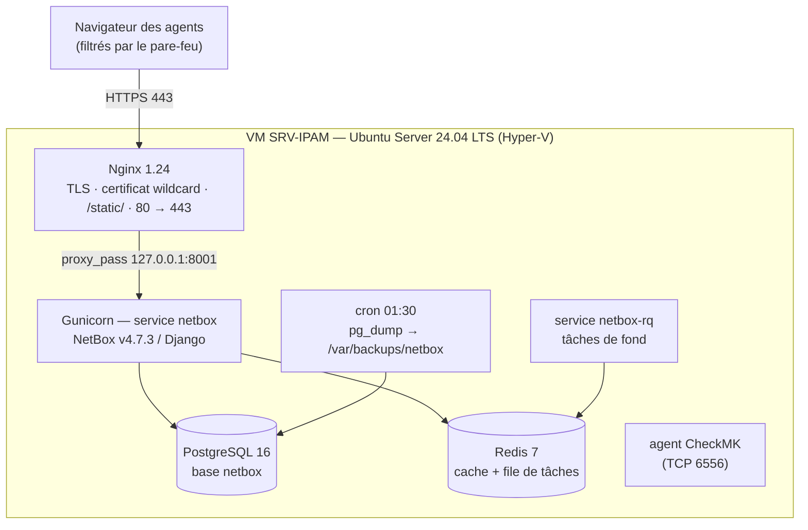

# NetBox — Déploiement d'un IPAM / DCIM en production


> Déploiement de **NetBox** en production, de l'installation du serveur jusqu'à l'alimentation des données, pour en faire la **source de vérité** du réseau.

> [!NOTE]
> Toutes les données de ce dépôt sont anonymisées : adresses IP de documentation (RFC 5737), domaine `example.org`, noms de serveurs, de sites et d'équipements génériques. Aucun secret n'est publié.

## Présentation du projet

### Qu'est-ce qu'un IPAM ? Qu'est-ce qu'un DCIM ?

- **IPAM** (*IP Address Management*) : l'inventaire logique du réseau. Il recense les réseaux (VLAN, préfixes), les plages d'adresses et chaque adresse IP attribuée : **qui a quelle IP, où et pourquoi**.
- **DCIM** (*Data Center Infrastructure Management*) : l'inventaire physique. Il recense les sites, les bâtiments, les baies, les équipements, leur position et leurs connexions.

NetBox réunit les deux dans un même outil : chaque adresse IP est rattachée à l'interface d'un équipement, lui-même rattaché à un site et à une localisation.

<p align="center"></p>
<p align="center"><em>Tableau de bord de NetBox : vue d'ensemble des objets IPAM (préfixes, plages, adresses IP, VLAN) et DCIM (sites, baies, appareils).</em></p>

### Pourquoi un IPAM était nécessaire

Avant le projet, les adresses IP fixes du service étaient **dispersées dans plusieurs sources** : tableur des VLAN, outil de supervision, outil de découverte réseau, wiki interne, tableaux tenus par les référents, configuration du pare-feu, prestataire du réseau des écoles. Ces sources étaient parfois **contradictoires** (un même équipement avec deux IP différentes, des IP obsolètes encore supervisées), et il n'existait **aucune vue unique** permettant de savoir si une IP était libre, d'où un risque de conflit d'adresses.

Le parc concerné compte une quarantaine de sites (bâtiments administratifs, écoles, équipements sportifs, petite enfance, sites distants reliés en VPN) et des équipements très variés : switchs, bornes Wi-Fi, copieurs, onduleurs, chaufferies (GTB), alarmes, lecteurs de badges, serveurs, postes à IP fixe.

### Objectif

> [!IMPORTANT]
> **NetBox devient la source de vérité de l'équipe.** Règle posée : *tout ce qui a une IP fixe doit être dans NetBox*, et toute IP fixe y est réservée **avant** d'être configurée sur un équipement.

### Pourquoi NetBox

Open source, IPAM et DCIM dans un même outil, API REST, import CSV, journal des modifications, gestion fine des droits, large communauté et documentation officielle complète.

## Ce qui a été réalisé

- Installation **native** (sans Docker) sur une VM Ubuntu Server 24.04 LTS : PostgreSQL, Redis, NetBox, Gunicorn, Nginx.
- Mise en production en **HTTPS** avec le certificat wildcard de la structure, redirection HTTP → HTTPS.
- **Sauvegardes** automatiques de la base (pg_dump quotidien, rétention 14 jours) et **test de restauration**.
- **Supervision** du serveur par l'agent CheckMK.
- **Comptes nominatifs** et autorisations selon le principe du moindre privilège.
- Structuration de l'IPAM (VLAN, préfixes, plages DHCP) et du DCIM (sites, localisations, rôles, fabricants, types d'appareils, baies).
- **Alimentation des données** par import CSV, après croisement et validation des sources.

## Architecture



| Élément | Valeur |
|---|---|
| Serveur | VM `SRV-IPAM` — 4 vCPU, 8 Go RAM, 60 Go disque, génération 2, démarrage sécurisé |
| Adresse | 192.0.2.23 (VLAN serveurs) — `ipam.example.org` |
| Exposition | seul Nginx (443) est exposé ; Gunicorn et Redis n'écoutent qu'en local |
| Accès | 443 ouvert uniquement pour un groupe d'agents ; SSH uniquement depuis le poste d'administration |

## Versions

| Composant | Version | Minimum requis par NetBox |
|---|---|---|
| Ubuntu Server | 24.04.5 LTS | 22.04 / 24.04 |
| NetBox | v4.7.3 | — |
| Python | 3.12.3 | 3.12 |
| PostgreSQL | 16.15 | 15 |
| Redis | 7.0.15 | 6.0 |
| Nginx | 1.24.0 | — |
| Gunicorn / Django | 26.2.0 / 6.1.2 | fournis par NetBox |

## Documentation

| Document | Contenu |
|---|---|
| [Partie A — Contexte et choix techniques](Partie%20A%20%E2%80%94%20Contexte%20et%20choix%20techniques/contexte-et-choix-techniques.md) | Installation native, versions, HTTPS, secrets, comptes locaux |
| [Partie B — Installation](Partie%20B%20%E2%80%94%20Installation/procedure-installation.md) | Ubuntu, NTP, PostgreSQL, Redis, NetBox, Gunicorn, Nginx, sauvegardes, supervision |
| [Partie C — Mise en production](Partie%20C%20%E2%80%94%20Mise%20en%20production/mise-en-production.md) | Chronologie, validation, checklist, exploitation |
| [Partie D — IPAM, DCIM et source de vérité](Partie%20D%20%E2%80%94%20IPAM%2C%20DCIM%20et%20source%20de%20v%C3%A9rit%C3%A9/ipam-dcim-source-de-verite.md) | Fonctionnalités utilisées, hiérarchie des sources, méthode d'import CSV |
| [Partie E — Comptes et droits](Partie%20E%20%E2%80%94%20Comptes%20et%20droits/comptes-et-droits.md) | Modèle de droits, autorisations, exclusions |
| [Partie F — Utilisation au quotidien](Partie%20F%20%E2%80%94%20Utilisation%20au%20quotidien/utilisation-au-quotidien.md) | Réserver une IP, ajouter un équipement, rechercher |
| [Partie G — Difficultés et leçons retenues](Partie%20G%20%E2%80%94%20Difficult%C3%A9s%20et%20le%C3%A7ons%20retenues/difficultes-et-lecons.md) | Problèmes techniques, qualité des données, prise en main |

## Organisation du dépôt

```text
netbox-ipam-dcim/
├── README.md
├── Partie A — Contexte et choix techniques/
├── Partie B — Installation/
├── Partie C — Mise en production/
├── Partie D — IPAM, DCIM et source de vérité/
├── Partie E — Comptes et droits/
├── Partie F — Utilisation au quotidien/
└── Partie G — Difficultés et leçons retenues/
```

## Compétences mobilisées

- **Administration système Linux** : installation d'un serveur, services systemd, permissions, NTP, cron.
- **Services web** : reverse proxy Nginx, TLS et chaîne de certification, Gunicorn.
- **Bases de données** : PostgreSQL, sauvegarde et restauration.
- **Sécurité** : moindre privilège, gestion des secrets, exposition minimale des services, filtrage pare-feu.
- **Qualité des données** : croisement de sources, validation avant import, vérification après import.
- **Gestion de projet** : découpage en étapes, travail avec plusieurs interlocuteurs (responsable, RSSI, référents métier, prestataire), documentation utilisateur et d'exploitation.
